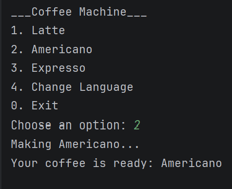
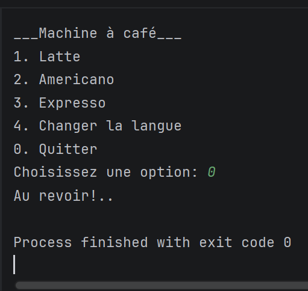

# Coffee Machine Simulator

A console-based Java application that simulates a coffee machine using object-oriented programming principles. Users can select different coffee types and switch between English and French through a menu-driven interface.

## Features

- Select from multiple coffee types
- English and French language support
- Menu-driven user interface
- Custom exception handling
- Audio feedback

## Technologies

- Java
- Object-Oriented Programming (OOP)
- Resource Bundles
- Exception Handling

## Screenshots

### English menu

### French menu

## Academic Context

Developed as part of coursework for the BSc Computing (Information Technology) programme at Technological University Dublin.